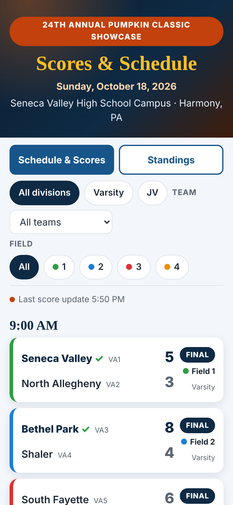
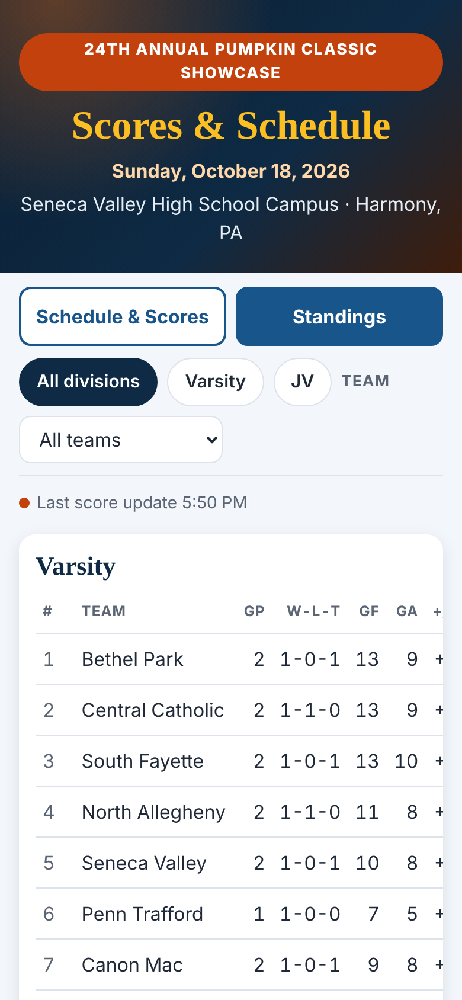
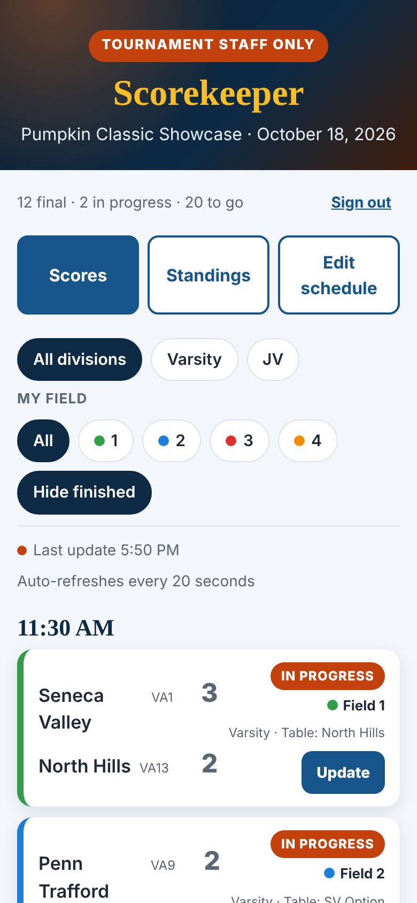
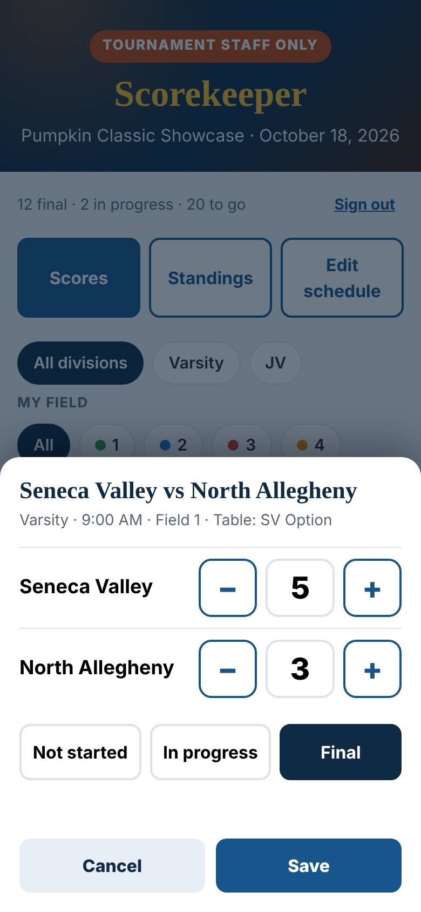
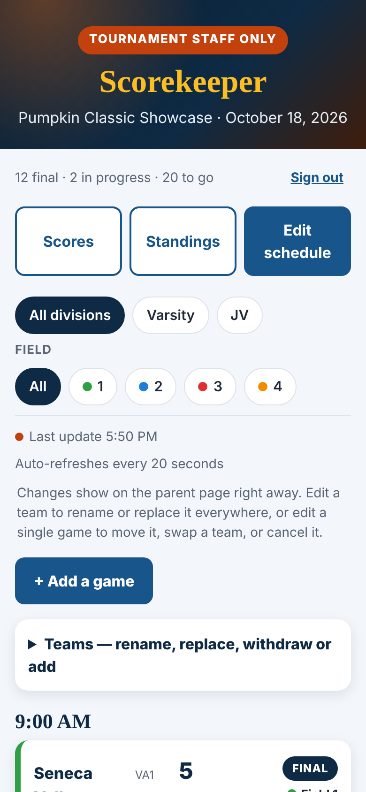

# Tournament Score Hub

A free, mobile-first scoreboard for youth sports tournaments. Parents open one link on their phone and see the schedule, scores and standings all day. Tournament staff sign in on their own phones to enter scores, and they can fix the schedule themselves when something changes.

Built for the **Seneca Valley Lacrosse Association (SVLA)** and its **Pumpkin Classic Showcase** (4 turf fields, Varsity and JV brackets, 34 games in one day). Nothing in it is specific to lacrosse, so it works for any round-robin or showcase-style event: soccer, field hockey, basketball, baseball and so on.

> **Live example:** https://scores.svlacrosse.org (staff: `/score`)

---

## Screenshots

Phone-sized views with sample scores.

| Parents: schedule | Parents: standings |
|:--:|:--:|
|  |  |

| Staff: scores | Staff: enter a score | Staff: edit schedule |
|:--:|:--:|:--:|
|  |  |  |

---

## Why this exists

Tournament day is chaotic. Parents wander between fields asking "who's playing now, and what was the score?" Paper schedules go stale the moment a game moves, a team drops out, or a field changes. This project gives families one link that is always current, and gives the volunteers running the event a simple tool that doesn't need an IT person standing next to them.

**Design goals**

- **Parents:** open the link, see their team, done. No app, no login, no ads.
- **Staff:** enter a score in two taps. Handle cancellations, late teams and added games without calling a developer.
- **Cheap and low-maintenance:** runs on Vercel's free tier. No database server to manage and no build step.
- **Reusable:** swap the schedule and you have a scoreboard for the next event.

---

## Features

### For parents (`/`)

- **Schedule & Scores:** every game grouped by time slot, with in-progress and final scores, a "Now / Up next" badge on event day, and winners highlighted.
- **Filters:** by division, by team (remembered on the device), and by field.
- **Standings:** wins-losses-ties, goals for/against and goal differential per division. Only final scores count, and cancelled games are ignored.
- **Auto-refresh:** updates itself every 30 seconds, and again when the phone wakes up. No manual reload.
- **Embeddable:** can be placed in an iframe on your club website (it resizes itself). The security headers allow only the sites you list.
- **Accessible and fast:** plain HTML, CSS and JavaScript. Large tap targets, readable on a sideline in sunlight.

### For staff (`/score`)

Passcode-protected. Three tabs:

- **Scores**
  - Large `+` / `−` steppers for each team, plus a Not started / In progress / Final status.
  - "My field" filter, so a scorekeeper sees only the games they are responsible for.
  - "Hide finished" to keep the list short as the day goes on.
- **Standings:** the same tables parents see, without signing out.
- **Edit schedule**
  - **Rename or replace a team:** every game and the score-table list update everywhere.
  - **Add a team** to either division.
  - **Withdraw a team:** cancels all of its games at once, with an automatic note.
  - **Move or edit a game:** change the time, field, teams or table duty. Cancel a game with an optional note such as "Forfeit".
  - **Add a brand-new game** between any two teams in a division.
  - **Delete** games and teams that staff added. Original teams and games can be reset or cancelled instead.
  - **Reset** a single game, or everything, back to the original schedule.
  - **Conflict protection:** the server rejects double-booked fields, a team playing twice in one slot, a team playing itself, and cross-division games, with a plain-English message.

Destructive buttons use a two-tap confirmation instead of browser pop-ups, which are unreliable on phones.

---

## How it works

```
 Parents  ──►  /  (static page) ──┐
                                  ├──►  /api/state     ──►  Vercel Blob (one JSON document)
 Staff    ──►  /score ────────────┤     /api/score     (passcode required)
                                  └──►  /api/edit      (passcode required)
```

- **Frontend:** vanilla ES modules, no framework and no build step. Everything in `public/` is served as-is.
- **Backend:** Vercel serverless functions in `api/`.
- **Storage:** a single small JSON document (scores plus schedule edits) in a **private Vercel Blob** store.
- **Base schedule:** lives in code (`lib/schedule.js`). Staff changes are saved as "edits" layered on top of it (`lib/apply.js`), which is why "reset to original" is always possible.
- **Concurrency:** writes use an ETag check (`ifMatch`) with automatic retry, so two scorekeepers saving at the same moment cannot silently overwrite each other.
- **Caching:** the parent view caches `/api/state` for 10 seconds at the edge, which keeps load and cost near zero even if hundreds of parents refresh at once. The staff view always bypasses the cache and sees changes immediately.

### State shape

```jsonc
{
  "scores": { "V01": { "a": 5, "b": 3, "status": "final", "updatedAt": "…" } },
  "edits": {
    "teams": { "VA15": "New Team" },      // renames and added teams
    "games": { "V03": { "slot": 4, "field": 2, "cancelled": false, "note": "" } },
    "table": { "2:5": "Plum" },           // score-table duty overrides ("field:slot")
    "added": { "A1": { "div": "Varsity", "a": "VA3", "b": "VA7", "slot": 8, "field": 4 } }
  },
  "updatedAt": "…"
}
```

---

## Project layout

```
api/
  state.js      GET   scores + edits (parents: short cache; staff: ?fresh=1)
  schedule.js   GET   the base schedule
  login.js      POST  checks the staff passcode
  score.js      POST  saves a score (passcode required)
  edit.js       POST  schedule changes, validated server-side (passcode required)
lib/
  schedule.js   THE BASE SCHEDULE: slots, fields, teams, games, score-table duty
  apply.js      applies staff edits to the base schedule (server copy)
  store.js      Vercel Blob read/write with ETag retry (+ a local file store for testing)
  auth.js       passcode check, rate limiting
  http.js       small JSON response helper
public/
  index.html, view.js   parent page
  score.html, score.js  staff page
  shared.js             helpers shared by both, including a browser copy of apply.js
  styles.css            all styling and the club colors
scripts/
  dev-server.mjs        local server that mimics Vercel routing
  validate-schedule.mjs sanity checks for a schedule (double-bookings and so on)
vercel.json             clean URLs, region, security headers
```

> `lib/apply.js` and the `applyEdits` function in `public/shared.js` are intentional copies, one for the server and one for the browser. **Keep them identical** when you change either.

---

## Deploy your own

You need a free [Vercel](https://vercel.com) account (and optionally a GitHub account to auto-deploy).

1. **Get the code.** Fork or clone this repo.
2. **Create the project.** Import the repo into Vercel. No framework preset and no build command are needed. It's a static site plus functions.
3. **Create a Blob store.** In the Vercel project, go to Storage → Create → **Blob**, make it **private**, and connect it to the project. This adds the `BLOB_READ_WRITE_TOKEN` environment variable automatically.
4. **Set the staff passcode.** Under Settings → Environment Variables, add `ORGANIZER_PASSCODE` (mark it Sensitive) for Production and Preview. Pick something your volunteers can type on a phone.
5. **Deploy.** Push to `main`, or press Deploy. Open `/score`, sign in, and try a test score.
6. **(Optional) custom domain.** Settings → Domains → add e.g. `scores.yourclub.org`. At your DNS provider, create a CNAME for `scores` pointing to `cname.vercel-dns.com`. If you use Cloudflare, set it to **DNS only** (grey cloud) so Vercel can issue the certificate.

> **Fails closed:** if `ORGANIZER_PASSCODE` is not set, all score and edit endpoints refuse to work (HTTP 503). Nobody can edit anything by accident.

### Running locally

```bash
npm install
STORE=file ORGANIZER_PASSCODE=test PORT=3000 node scripts/dev-server.mjs
# parents: http://localhost:3000     staff: http://localhost:3000/score
```

`STORE=file` keeps state in `.data/state.json` instead of Vercel Blob. Check a schedule for mistakes with:

```bash
node scripts/validate-schedule.mjs
```

---

## Adapting it for another event or sport

Most of the work is editing **`lib/schedule.js`**:

| Change | Where |
|---|---|
| Time slots, fields and field names | `SLOTS`, `FIELDS` |
| Teams | `TEAMS` (codes are `VA1…` for Varsity and `JV1…` for JV) |
| Games | `RAW` (division, slot index, field, team A, team B) |
| Score-table / duty assignments | `TABLE` |
| Event date (drives the "Now / Up next" badge) | `EVENT_DATE` in `public/shared.js` |
| Event name and branding text | the titles and hero text in `public/index.html` and `public/score.html` |
| Colors and fonts | CSS variables at the top of `public/styles.css` |
| Storage key | `BLOB_PATH` in `lib/store.js`, so each event keeps its own data |

Then run `node scripts/validate-schedule.mjs`, deploy, and rehearse once with your scorekeepers.

**Current limitations (honest list)**

- **Two divisions:** the code assumes `VA` (Varsity) and `JV` division prefixes in a few places. Different divisions mean small code edits (`divOf` in `api/edit.js`, `standings` in `public/shared.js`).
- **Round-robin only:** there is no bracket or playoff tree. The standings are informational: wins, then goal differential, then goals for. There are no head-to-head or other tiebreaker rules.
- **No separate forfeit status:** record a forfeit as a final score, or cancel the game with a note.
- **One event per deployment:** reusing it for another tournament means changing the schedule file (or deploying a second copy).
- **Scores are not instant for parents:** the edge cache plus the 30-second refresh means parents see changes within roughly 10 to 40 seconds.
- **Single shared passcode:** it is simple on purpose, but there is no per-person audit trail.

---

## Security and privacy

- **No personal data:** only team names, scores and a schedule. No parent or player accounts, and no tracking.
- **Passcode:** compared with a constant-time check, stored only as a Vercel environment variable, and never sent to the page. Repeated wrong guesses are rate-limited.
- **Server-side validation:** every schedule change is checked on the server, never trusted from the browser. Text is escaped before display.
- **Iframe policy:** `vercel.json` sets `frame-ancestors` so the page can be embedded only on the domains you list. Update it to your own site.
- **Staff page** is marked `noindex` so search engines skip it.
- **Rotate the passcode** after the event if it was shared widely. It is one environment variable.

---

## Tournament-day checklist

1. Rehearse a day or two before: sign in on real phones, enter test scores, try a team withdrawal, add a game, and look at standings.
2. Clear test data with **Edit schedule → Reset all schedule changes**, and set any test games back to "Not started".
3. Share the parent link and put it on signs, QR codes and the club website.
4. Give each scorekeeper the staff link and passcode, and tell them to use the **My field** filter.
5. Keep one person ready for schedule changes: late teams, moved games, cancellations.

---

## License

Released under the **GNU General Public License v3.0**. See [LICENSE](LICENSE).

Built by the SVLA tech volunteers. Contributions and ideas from other clubs are welcome.
